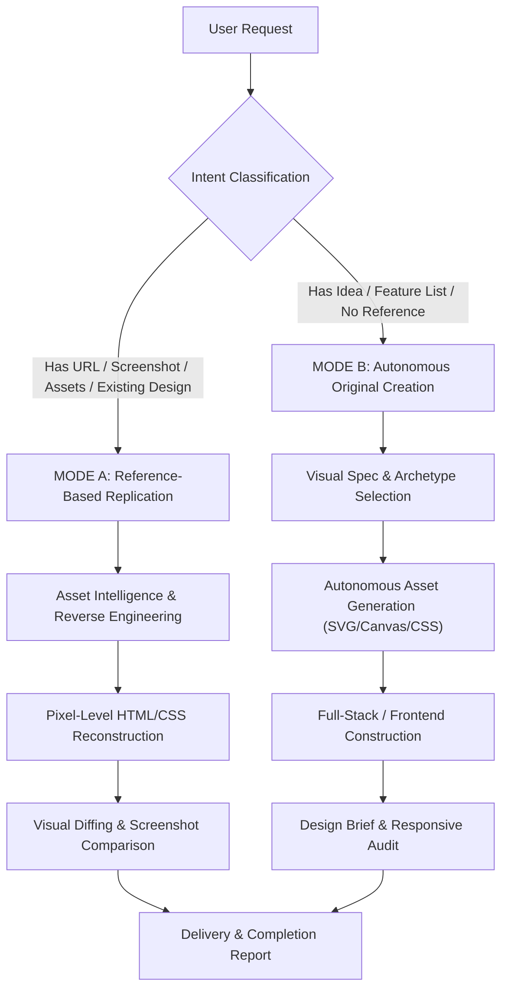

# Autonomous Website Architect

An enterprise-grade Antigravity skill that enables autonomous design, high-fidelity reconstruction, and end-to-end frontend construction of modern, responsive websites and web applications.

---

## 1. Dual Operating Modes



### MODE A: Reference-Based Replication
Activate when the user provides:
- A live website URL
- Screenshots or UI mockups
- A folder of downloaded assets
- An existing codebase to clone or refactor
- *Goal*: Build an exact, pixel-perfect, responsive replica that preserves the original layout, typography, palette, layers, animations, and interactive controls.
- *Detailed Runbook*: [Mode A Replication Runbook](references/mode-a-replication.md).

### MODE B: Autonomous Original Website Creation
Activate when the user provides:
- A product idea, business pitch, feature list, or prompt without visual references
- *Goal*: Act as lead designer and architect. Autonomously establish visual direction, color system, typography pairings, layout hierarchy, and create original visual assets (SVGs, canvas, CSS art, or generative imagery).
- *Detailed Runbook*: [Mode B Creation Runbook](references/mode-b-creation.md).

---

## 2. Intent Auto-Classification

Classify the user's prompt immediately without stalling:
1. **Clone an existing website** $\rightarrow$ Mode A
2. **Recreate website from screenshot** $\rightarrow$ Mode A
3. **Build website from idea / prompt** $\rightarrow$ Mode B
4. **Redesign / improve existing interface** $\rightarrow$ Inspect current codebase, identify weaknesses, apply Mode B design tokens while preserving existing functionality.
5. **Multi-page web application** $\rightarrow$ Establish shared layout, configure declarative routing (`react-router-dom` or Next.js App Router), build individual page views.

> [!IMPORTANT]
> If the user's intent is clear, start working immediately. Never interrogate the user about trivial choices (e.g. "What hex color do you prefer?"). Use professional design judgment.

---

## 3. Autonomous Design Intelligence (Archetypes)

When in **Mode B**, do not fall back on generic, bland SaaS templates unless building enterprise software. Select one of the 7 core design archetypes:

1. **Gaming & Immersive**: Dark umber/black, warm torchlight orange, gold coins, condensed display typography (*Bebas Neue*), slanted cut corners (`clip-path: polygon(...)`), sprite animations, drifting embers.
2. **Crypto & Web3**: Midnight slate, cyan electric blue, violet neon, geometric display (*Syne*), monospaced data figures (*JetBrains Mono*), live SVG sparklines, frosted glassmorphism.
3. **Modern SaaS & DevTools**: Dark carbon, indigo-violet accents, crisp neo-grotesque type (*Plus Jakarta Sans*, *Inter*), interactive tabbed features, code snippets, pricing toggles.
4. **Luxury & E-Commerce**: Deep basalt, champagne gold, ivory cream, high-contrast serif (*Playfair Display*), clean product cards, filter drawers, cart slide-outs.
5. **Creative Portfolio**: High-contrast black and white, vibrant punch accent (hot pink/lime), massive display type (*Clash Display*), interactive project galleries, magnetic buttons.
6. **Operations Dashboard**: Dense deep slate, high-contrast status colors (emerald, amber, rose), tabular numbers, paginated tables, KPI metric badges.
7. **Enterprise Business**: Sapphire corporate blue, clean grid lines, structured 12px rounded cards, multi-step lead forms, compliance trust badges.

To generate production-ready CSS variables for any archetype, run:
```bash
python "C:/Users/User/.gemini/config/skills/autonomous-website-architect/scripts/design_token_generator.py" <archetype>
```
*Full archetype details*: [Design Systems Reference](references/design-systems.md).

---

## 4. Autonomous Asset Strategy

Do not depend on the user supplying images for original builds.
- **Vector Icons & Logos**: Write clean, custom inline SVGs with appropriate viewBox, stroke, and fill tokens.
- **Hero & Feature Visuals**: Build layered CSS gradient meshes, SVG isometric diagrams, or HTML5 canvas particle generators (stars, glowing embers, matrix rain).
- **Cutout Graphics**: When using local assets or generated images, preserve PNG/WebP alpha transparency.
- **Cataloging Existing Assets**: Always run the built-in scanner:
  ```bash
  python "C:/Users/User/.gemini/config/skills/autonomous-website-architect/scripts/asset_analyzer.py" "<assets_folder>"
  ```
  *Asset mapping guide*: [Asset Intelligence Guide](references/asset-intelligence.md).

---

## 5. Technology Stack & Project Setup

1. **Inspect Existing Files**:
   - Always check the current working directory first.
   - Preserve existing configuration (`package.json`, Vite/Next.js/Tailwind configs) and working features.
2. **Default Frontend Architecture**:
   - If starting fresh, scaffold **React + Vite + TypeScript**.
   - Modular component structure:
     - `components/Header.tsx`
     - `components/HeroSection.tsx`
     - `components/FeaturesGrid.tsx`
     - `components/InteractiveWidget.tsx` (real working interactive calculator, filter, or preview)
     - `components/Pricing.tsx` (with monthly/annual billing switch)
     - `components/FaqSection.tsx` (collapsible accordions)
     - `components/FinalCta.tsx`
     - `components/Footer.tsx`
     - `components/MobileMenuDrawer.tsx`
3. **Multi-Page & Full-Stack Projects**:
   - When SSR, API routes, or databases are requested, select a suitable framework (Next.js, Remix, or Express backend) instead of forcing client-only Vite.

---

## 6. Mandatory Browser Testing & Continuous Refinement

Every completed website must be verified using the local development server and browser automation:

```bash
# Start local server
npx vite --port 5173 --host
```

1. **Multi-Viewport Inspection**:
   - Desktop: `1440 × 900`
   - Laptop: `1280 × 800`
   - Tablet: `768 × 1024`
   - Mobile: `390 × 844`
   - Small Mobile: `360 × 740`
2. **Zero Horizontal Overflow Test**:
   Ensure `document.documentElement.scrollWidth <= window.innerWidth` across all viewports.
3. **Console Zero-Error Guarantee**:
   Ensure 0 uncaught JavaScript errors, 0 missing image 404s, and 0 React DOM property warnings.
4. **Visual Iteration Loop**:
   - Capture screenshots.
   - Compare against the reference (Mode A) or visual specification (Mode B).
   - Identify the **Top 5 Visual Flaws**, fix them in CSS/JSX, and re-verify.
   *Verification checklist*: [Browser Verification Protocol](references/browser-verification.md).

---

## 7. Completion Report Format

Deliver a structured completion report containing:
1. **Operating Mode & Archetype**: Mode A (Reference Replica) or Mode B (Autonomous Original), with selected aesthetic archetype.
2. **Implemented Structure**: List of pages, sections, and responsive features created.
3. **Assets Strategy**: Reused assets, custom SVGs, canvas effects, or generative imagery created.
4. **Functional Capabilities**: Working client-side state, calculators, accordions, drawers, and form interactions.
5. **Quality & Verification Summary**: Viewports tested, overflow verification (`0px`), console status (`0 errors`), and build status (`npm run build`).
6. **Local Run Commands**: Exact commands to start and test the application.
