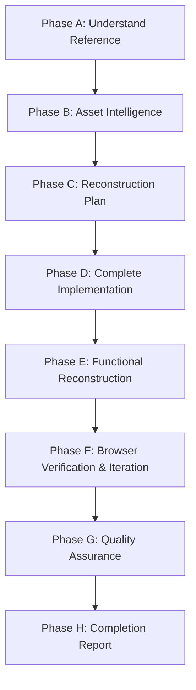

# Pixel-Perfect Website Replica

This skill guides you through reverse-engineering, reconstructing, and validating an exact, production-ready frontend replica of an existing website using reference URLs, full-page screenshots, local asset folders, and existing project files.

---

## Core Philosophy & Visual Fidelity Rules

1. **Pixel-Level Faithfulness Over Generic Modernization**:
   - Recreate the exact visual identity, colors, atmospheric lighting, fonts, and geometry of the reference.
   - Do **NOT** redesign, simplify, or convert a cinematic, dark, or vintage aesthetic into a generic SaaS template with plain white cards and oversized rounded borders.
2. **True Structural Markup**:
   - Never flatten sections into static monolithic images.
   - Separate background artwork, character illustrations, text layers, and interactive controls into proper HTML/CSS layers.
3. **Asset Integrity**:
   - Use original local assets wherever available. Never replace original artwork with AI-generated approximations or generic stock icons when the real files are supplied.
   - Preserve PNG and WebP alpha transparency.
4. **Mandatory Visual Verification**:
   - Never complete a website replica task without launching the local dev server, taking screenshots across viewports, and visually comparing them with the reference.

---

## 8-Phase Execution Workflow



---

### Phase A — Understand the Reference

1. **Locate Inputs**: Identify the reference URL, screenshot files (e.g. `website full page Screenshot.png`), local asset directories, and existing codebase.
2. **Inspect Existing Project**:
   - Check framework (`React`, `Vue`, `Next.js`, or static HTML/CSS), package manager (`npm`, `pnpm`, `yarn`), and entry points.
   - If an existing codebase is already initialized, preserve its architecture and configuration.
   - If starting from an empty directory, choose **React + Vite + TypeScript** with clean CSS / CSS Modules as the modern default.
3. **Inspect Original Website**:
   - If the URL is live and accessible, fetch `index.html`, stylesheet URLs, scripts, and fonts.
   - If the original site cannot be fetched or is protected, use the full-page screenshot and local assets as the primary source of truth.
4. **Deconstruct Page Sections**:
   - Header, navigation, and top CTA buttons.
   - Hero banner (headline typography, gradient accents, hero artwork, lead copy, HUD statistics, scroll cues).
   - Core thematic chapters / feature sections.
   - Interactive showcases (world maps, carousels, mining consoles, sliders, level progression tables).
   - Reward grids, daily check-in blocks, tokenomics / coin showcases.
   - Code of conduct, rules, or security sections.
   - Collapsible FAQs and accordion items.
   - Final CTA section with glowing emblems and social media badges.
   - Footer with brand summary, categorized navigation columns, and legal disclaimers.

---

### Phase B — Asset Intelligence

Run the skill's helper script to catalog and analyze all provided assets:
```bash
python "C:/Users/User/.gemini/config/skills/pixel-perfect-website-replica/scripts/asset_analyzer.py" "<path_to_asset_folder>"
```

1. **Categorize by Type**:
   - Backgrounds & Scene Art: High-resolution scenery (e.g. 800×480 or 1600×686 WebP/JPG).
   - Character Cutouts: Transparent PNG/WebP files ($\approx 150-250\text{px}$ wide).
   - Spritesheets: Images with extreme aspect ratios ($\ge 3:1$ or $\le 0.33:1$). Count frames: $\text{Frames} = \frac{\text{Width}}{\text{Frame Width}}$.
   - Vector Graphics: SVGs for routes, icons, noise filters, and social logos.
   - Branding: Favicon, Apple Touch icon, OpenGraph banner, token coin artwork.
2. **Deduplication & Hash Matching**:
   - Compute SHA-256 hashes to match duplicated files or files renamed with UUIDs/suffixes.
3. **Directory Organization**:
   - Place assets into standard directories (e.g., `public/assets/img/`, `public/assets/mines/`, `public/assets/miners/`, `public/assets/icons/`).
   - For detailed asset matching rules, consult [Asset Intelligence Guide](references/asset-intelligence.md).

---

### Phase C — Visual Reconstruction Plan

Formulate an internal component and layout plan before writing code:
- Component hierarchy (e.g., `Header`, `HeroSection`, `HowItWorksSection`, `LegendaryMinesSection`, `CrewSection`, `ForgeSection`, `DailyLootSection`, `CoinSection`, `FairPlaySection`, `FaqSection`, `FinalCtaSection`, `Footer`, `MobilePlayBar`).
- Color palette tokens (`--bg`, `--ink`, `--panel`, `--line`, `--torch`, `--amber`, `--cream`, `--mute`).
- Typography system (`--display` font, `--body` font, `--hud` font).
- Slanted cut corners (`clip-path: polygon(...)`), drop shadows, and radial vignettes.
- Proceed directly from plan to code without stopping or asking unnecessary questions.

---

### Phase D — Complete Website Implementation

Build the **entire page** from top to bottom. Do not omit any visible section.

1. **Design Tokens & Global CSS**:
   - Configure CSS custom properties for colors, typography, max widths, header height, and cut geometry.
   - Add noise film grain (`.grain` with SVG fractalNoise filter) and animated rising embers (`.embers`).
2. **Typography**:
   - Import Google Fonts or local font files (e.g., *Bebas Neue*, *Barlow*, *Barlow Condensed*).
   - Replicate uppercase letter spacing (`letter-spacing: .02em` to `.3em`), line-heights, and gradient text fills (`-webkit-background-clip: text; color: transparent;`).
3. **Buttons & Controls**:
   - Slanted polygon button cuts (`clip-path: polygon(14px 0, 100% 0, 100% calc(100% - 14px), calc(100% - 14px) 100%, 0 100%, 0 14px)`).
   - Torchlight gradients, hover brightness, drop shadows, and active states.
4. **Cards & Panels**:
   - Double-cut borders using layered linear gradients (`linear-gradient(135deg, ...)`) and inset box shadows.
   - Radial glow spotlights behind cards and tokens.

---

### Phase E — Functional Reconstruction

Implement realistic, functioning client-side behaviors:
- **Mobile Menu**: Responsive hamburger button that toggles a slide-out drawer with ESC key and backdrop support.
- **Carousels & Horizontal Tracks**: Smooth scroll by card offset, progress bar indicator, slide counter (`01 / 10`), and interactive map pin synchronization.
- **Animated Sprites**: Use CSS `steps(N)` animations on sprite strips:
  ```css
  .sprite {
    background-size: calc(var(--frames) * 100%) 100%;
    animation: dig calc(var(--frames) / var(--fps) * 1s) steps(var(--frames)) infinite;
  }
  @keyframes dig {
    to { background-position-x: calc(100% * var(--frames) / (var(--frames) - 1)); }
  }
  ```
- **Interactive Calculators / Considers**: Wire inputs, logarithmic ranges, and preset buttons to stateful calculations and dynamic image previews.
- **One-Click Clipboard Copy**: Copies address/code with brief "Copied" feedback state.
- **Collapsible FAQs**: Clean `<details>` / `<summary>` accordions with rotating `+` icon.
- **Clear Backend Boundaries**: Never fake financial transactions or private backend logins. Clearly identify demo/frontend integrations.

---

### Phase F — Browser Testing & Visual Comparison

**This phase is mandatory.** Never claim pixel-perfect accuracy without verifying screenshots.

1. Start the local server:
   ```bash
   npx vite --port 5173 --host
   ```
2. Launch browser automation via Playwright or Chrome DevTools MCP.
3. Ensure all scroll reveal animations or `.reveal` elements have triggered (e.g., scroll through the page or add `.reveal.in`).
4. Test and capture screenshots at standard viewport sizes:
   - **1440 × 900** (Desktop standard)
   - **1280 × 800** (Laptop)
   - **768 × 1024** (Tablet)
   - **390 × 844** (Modern Mobile)
   - **360 × 740** (Compact Mobile)
5. Read and compare screenshots:
   - Check hero composition, character artwork alignment, and headline scale.
   - Verify card alignments, margins, and vertical rhythm.
   - Identify the **Top 5 Visual Mismatches**, refine CSS/JSX, and re-verify.
   - For detailed guidance, consult [Visual Inspection Checklist](references/visual-inspection-checklist.md) and [Responsive Verification Protocol](references/responsive-verification.md).

---

### Phase G — Quality Assurance Checklist

Before reporting completion, verify every item:
- [ ] Every section from the reference is implemented (no truncated sections).
- [ ] Correct local assets are loaded; zero 404 image errors.
- [ ] Browser console has 0 errors and 0 warnings.
- [ ] Zero horizontal overflow (`document.documentElement.scrollWidth <= window.innerWidth`).
- [ ] Interactive controls (menus, sliders, tabs, buttons, accordions) operate cleanly.
- [ ] Production build succeeds (`npm run build`).
- [ ] Consult [Quality Assurance Audit](references/quality-assurance-audit.md) for full audit criteria.

---

### Phase H — Completion Report

Deliver a concise final report structured with:
1. **What was implemented**: Sections, layout, and visual components.
2. **Reused assets**: Exact files mapped from local asset directories.
3. **Functional features**: Working interactive mechanics, calculations, carousels, and animations.
4. **Third-party / backend dependencies**: Clear demarcation of backend services.
5. **Visual verification results**: Viewports verified, overflow status, and screenshot comparison findings.
6. **Local run command**: Exact command to run the website locally.
